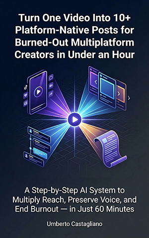

# Turn One Video Into 10+ Platform-Native Posts for Burned-Out Multiplatform Creators in Under an Hour

*A Step-by-Step AI System to Multiply Reach, Preserve Voice, and End Burnout — in Just 60 Minutes*

## About this repository

You finish one solid video, then lose the rest of your day rewriting it for every platform. This repository is the companion home for the practical materials in the book — the templates, exercises, prompt libraries, and decision tools that turn a single pillar piece into platform-native drafts you can publish with confidence. Everything here is organized to follow the book's progression, so you can move from mindset work into the full system and then into advanced optimization.

You can browse each chapter's workbook, copy the prompts into your own tools, and return whenever the book's frameworks need a refresh. The print edition gives you the concepts; this repository gives you the living, editable files you can put to work today.

## What's inside

Each chapter folder contains a workbook with the exercises, prompt templates, checklists, and reflection prompts referenced in the book. You'll find a voice-extraction exercise, a master document template, starter and advanced prompt libraries, a platform-format playbook, a repurposing decision matrix, workflow diagrams, and a 30-day calendar planning sheet — all designed to be copied, edited, and used directly in your own workspace.

## How to use these workbooks

- Browse the chapter folders in order, or jump to the chapter whose framework you need right now.
- Open any Markdown file directly on GitHub — it renders automatically with headings, lists, and formatting intact.
- Download individual files or clone the whole repository for offline use in a Markdown editor like Obsidian or any plain text app.
- Work digitally when you plan to copy prompts into your AI tools; print the checklists and calendars if you prefer paper.
- Keep a document editor and your AI assistant of choice open alongside these files, since most exercises ask you to draft and test.

## Chapters

- [Chapter 1 — From Content Factory to Editorial Powerhouse](./Chapter-1/Readme.md)
- [Chapter 2 — The Authentic AI Cocreator Pact](./Chapter-2/Readme.md)
- [Chapter 3 — The Platform-Native Storytelling Code](./Chapter-3/Readme.md)
- [Chapter 4 — Building Your Hub-and-Spoke Command Center](./Chapter-4/Readme.md)
- [Chapter 5 — Prompt Engineering the Voice Amplifier](./Chapter-5/Readme.md)
- [Chapter 6 — The Sixty-Minute Multi-Platform Sprint](./Chapter-6/Readme.md)
- [Chapter 7 — The Unified AI Editorial Workflow](./Chapter-7/Readme.md)
- [Chapter 8 — Advanced Prompt Craft for Magnetic Hooks and Arcs](./Chapter-8/Readme.md)
- [Chapter 9 — The Repurposing Decision Matrix](./Chapter-9/Readme.md)
- [Chapter 10 — Voice Amplification at Scale](./Chapter-10/Readme.md)
- [Chapter 11 — The Content Flywheel Automation System](./Chapter-11/Readme.md)
- [Chapter 12 — The Content Transformer Identity](./Chapter-12/Readme.md)

## About the author

Umberto Castagliano writes for creators who manage several platforms and want a repeatable way to adapt one piece of content without losing their voice. His work focuses on practical, AI-assisted editorial systems that fit into real production schedules. This book is self-published.

## Feedback and contact

Found something that could be clearer, or a prompt that needs a fix? Open an issue in this repository and describe what you ran into.

## License

Free to use for personal learning. Not for redistribution or resale.